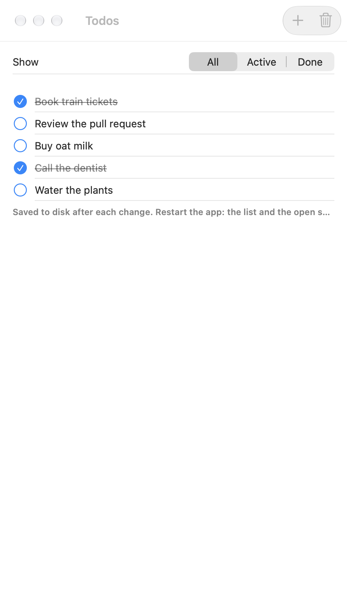
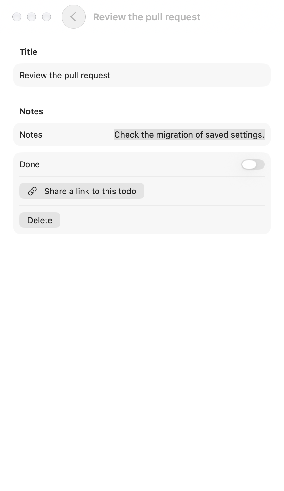
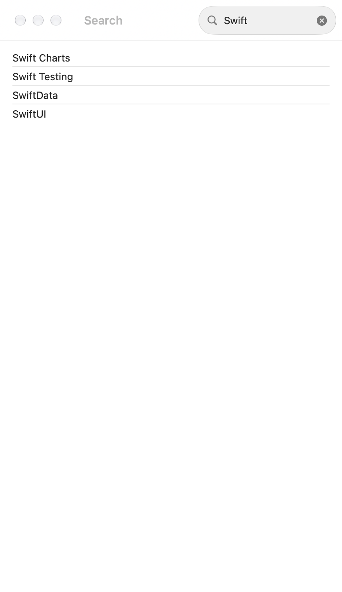
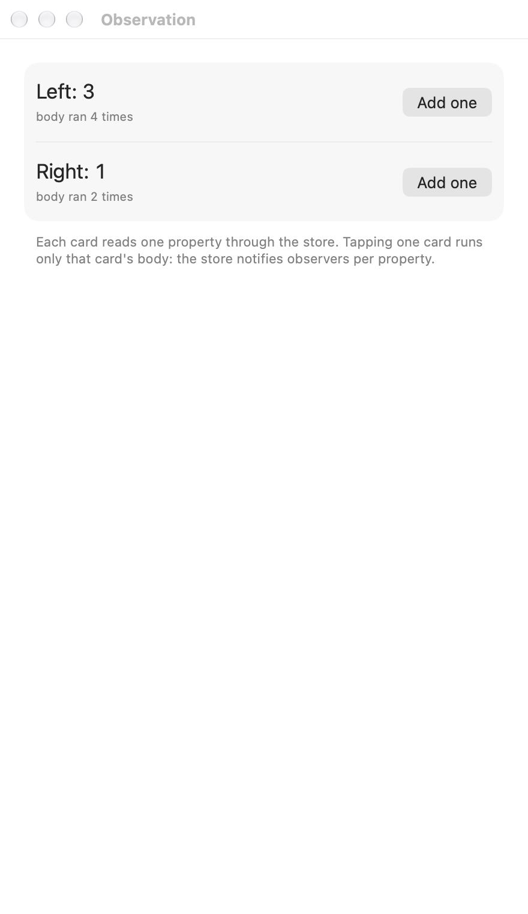

<!-- i18n-source: README.md@b40031a37de449c4b6b347a51e557e63c1f5981a status=reviewed -->
<!-- brand:start -->

<p align="center"><picture><source media="(prefers-color-scheme: dark)" srcset="https://raw.githubusercontent.com/muhittincamdali/SwiftUI-State-Management/main/.github/brand/banner-dark.svg"><source media="(prefers-color-scheme: light)" srcset="https://raw.githubusercontent.com/muhittincamdali/SwiftUI-State-Management/main/.github/brand/banner-light.svg"></picture></p>

<!-- lang-selector:start -->
<p align="center"><a href="README.md">English</a> · <a href="README.tr.md">Türkçe</a> · <a href="README.zh-CN.md">简体中文</a> · <a href="README.ja.md">日本語</a> · <a href="README.ko.md">한국어</a> · <a href="README.es.md">Español</a> · <a href="README.de.md">Deutsch</a> · <a href="README.fr.md">Français</a> · <a href="README.pt-BR.md">Português (Brasil)</a> · <a href="README.ru.md">Русский</a></p>
<!-- lang-selector:end -->

<p align="center">
<a href="https://github.com/muhittincamdali/SwiftUI-State-Management/actions/workflows/ci.yml"></a>
<a href="https://github.com/muhittincamdali/SwiftUI-State-Management/releases"><picture><source media="(prefers-color-scheme: dark)" srcset="https://raw.githubusercontent.com/muhittincamdali/SwiftUI-State-Management/main/.github/brand/badge-version-dark.svg"><source media="(prefers-color-scheme: light)" srcset="https://raw.githubusercontent.com/muhittincamdali/SwiftUI-State-Management/main/.github/brand/badge-version-light.svg"></picture></a>
<a href="https://github.com/muhittincamdali/SwiftUI-State-Management/blob/main/Package.swift"><picture><source media="(prefers-color-scheme: dark)" srcset="https://raw.githubusercontent.com/muhittincamdali/SwiftUI-State-Management/main/.github/brand/badge-platforms-dark.svg"><source media="(prefers-color-scheme: light)" srcset="https://raw.githubusercontent.com/muhittincamdali/SwiftUI-State-Management/main/.github/brand/badge-platforms-light.svg"></picture></a>
<a href="https://github.com/muhittincamdali/SwiftUI-State-Management/blob/main/Package.swift"><picture><source media="(prefers-color-scheme: dark)" srcset="https://raw.githubusercontent.com/muhittincamdali/SwiftUI-State-Management/main/.github/brand/badge-language-dark.svg"><source media="(prefers-color-scheme: light)" srcset="https://raw.githubusercontent.com/muhittincamdali/SwiftUI-State-Management/main/.github/brand/badge-language-light.svg"></picture></a>
<a href="https://github.com/muhittincamdali/SwiftUI-State-Management/blob/main/LICENSE"><picture><source media="(prefers-color-scheme: dark)" srcset="https://raw.githubusercontent.com/muhittincamdali/SwiftUI-State-Management/main/.github/brand/badge-license-dark.svg"><source media="(prefers-color-scheme: light)" srcset="https://raw.githubusercontent.com/muhittincamdali/SwiftUI-State-Management/main/.github/brand/badge-license-light.svg"></picture></a>
</p>

<p align="center">
<a href="#inicio-rápido"><picture><source media="(prefers-color-scheme: dark)" srcset="https://raw.githubusercontent.com/muhittincamdali/SwiftUI-State-Management/main/.github/brand/button-start-es-dark.svg"><source media="(prefers-color-scheme: light)" srcset="https://raw.githubusercontent.com/muhittincamdali/SwiftUI-State-Management/main/.github/brand/button-start-es-light.svg"></picture></a>
<a href="https://muhittincamdali.github.io/SwiftUI-State-Management/documentation/swiftuistatemanagement/"><picture><source media="(prefers-color-scheme: dark)" srcset="https://raw.githubusercontent.com/muhittincamdali/SwiftUI-State-Management/main/.github/brand/button-docs-es-dark.svg"><source media="(prefers-color-scheme: light)" srcset="https://raw.githubusercontent.com/muhittincamdali/SwiftUI-State-Management/main/.github/brand/button-docs-es-light.svg"></picture></a>
<a href="https://github.com/muhittincamdali/SwiftUI-State-Management/tree/main/Examples"><picture><source media="(prefers-color-scheme: dark)" srcset="https://raw.githubusercontent.com/muhittincamdali/SwiftUI-State-Management/main/.github/brand/button-examples-es-dark.svg"><source media="(prefers-color-scheme: light)" srcset="https://raw.githubusercontent.com/muhittincamdali/SwiftUI-State-Management/main/.github/brand/button-examples-es-light.svg"></picture></a>
</p>

> Esta es una traducción del README en inglés. Si hay diferencias, la versión en inglés es la vigente.

<!-- brand:end -->

SwiftUI State Management es un paquete pequeño de Swift 6 para el estado unidireccional en apps
SwiftUI a partir de iOS 17. Una funcionalidad es un reducer: un valor con un `State`, una `Action`
y un método que modifica el estado y devuelve el trabajo asíncrono que se debe iniciar. Un `Store`
lo ejecuta en el actor principal (main actor) e implementa `Observable`, de modo que las vistas lo
leen como un modelo `@Observable`, y registra las lecturas por propiedad sin macros. La navegación
es estado, la persistencia es un único modificador del reducer, y `TestStore` comprueba cada cambio
de estado y cada acción que envía un effect. No tiene dependencias.

## Lo más destacado

- **Flujo unidireccional sobre Observation** — las vistas leen `store.count` y llaman a
  `store.send(.incrementTapped)`; el reducer es el único lugar donde cambia el estado. La lectura
  de una propiedad almacenada `Equatable` se registra por separado, así que una vista que muestra
  `count` no se actualiza cuando cambia `title`.
- **Effects que puedes cancelar** — `.run` inicia una tarea en el actor principal; etiquétala con
  un id para cancelarla, o deja que `cancelInFlight` conserve solo la más reciente. Un effect
  cancelado no puede enviar resultados obsoletos, y el store cancela todo cuando desaparece.
- **La navegación como estado** — rutas de `NavigationStack`, sheets, alertas y destinos con enum
  mediante bindings que envían acciones, de modo que los deep links y las pruebas no necesitan
  ninguna vista.
- **Persistencia** — `persisting(\.items, to: .todos, in: storage)` guarda una parte del estado
  tras cada cambio, con debounce, vaciado (flush) a demanda, fuera del actor principal y en orden.
  Las claves tienen versión, un tamaño máximo y se validan, así que un nombre no puede salir del
  directorio del storage.
- **Pruebas exhaustivas** — `TestStore` falla con una diferencia línea por línea cuando un cambio
  de estado, una acción recibida o un effect pendiente no coincide con lo que dice la prueba;
  `TestClock` termina un debounce sin esperar.
- **Sinceridad sobre las alternativas** — la guía [Elegir un enfoque](Sources/SwiftUIStateManagement/SwiftUIStateManagement.docc/ChoosingAnApproach.md)
  explica cuándo bastan los modelos `@Observable` simples y cuándo
  [The Composable Architecture](https://github.com/pointfreeco/swift-composable-architecture)
  es la mejor opción.

## Inicio rápido

**1. Añade el paquete**

En Xcode, elige **File › Add Package Dependencies…** e introduce la URL del repositorio:

```text
https://github.com/muhittincamdali/SwiftUI-State-Management.git
```

**2. Importa el módulo**

```swift
import SwiftUIStateManagement
```

**3. Úsalo**

Describe la funcionalidad, muéstrala y crea el store
([ReadmeSamples.swift](Examples/StateDemo/StateDemo/ReadmeSamples.swift)):

```swift
struct Counter: Reducer {
    struct State: Equatable {
        var count = 0
        var fact: String?
        var isLoadingFact = false
    }

    enum Action: Equatable {
        case incrementTapped
        case decrementTapped
        case factTapped
        case factLoaded(String)
        case factFailed
    }

    let facts: NumberFacts

    func reduce(into state: inout State, action: Action) -> Effect<Action> {
        switch action {
        case .incrementTapped:
            state.count += 1
            state.fact = nil
            return .none
        case .decrementTapped:
            state.count -= 1
            state.fact = nil
            return .none
        case .factTapped:
            state.isLoadingFact = true
            return .run { [facts, count = state.count] send in
                send(.factLoaded(try await facts.fact(count)))
            } catch: { _, send in
                send(.factFailed)
            }
        case .factLoaded(let fact):
            state.isLoadingFact = false
            state.fact = fact
            return .none
        case .factFailed:
            state.isLoadingFact = false
            state.fact = "No fact this time."
            return .none
        }
    }
}

struct CounterView: View {
    let store: Store<Counter.State, Counter.Action>

    var body: some View {
        Form {
            Stepper("Count: \(store.count)") {
                store.send(.incrementTapped)
            } onDecrement: {
                store.send(.decrementTapped)
            }
            Button("Tell me a fact") { store.send(.factTapped) }
                .disabled(store.isLoadingFact)
            if let fact = store.fact {
                Text(fact)
            }
        }
    }
}
```

`NumberFacts` representa tu servicio: un struct con un closure asíncrono `fact(Int)`, para que las
pruebas puedan pasar uno falso. Una versión que no necesita red:

```swift
struct NumberFacts: Sendable {
    var fact: @Sendable (Int) async throws -> String
    static let local = NumberFacts { "\($0) is a number." }
}
```

Crea el store una sola vez, donde empieza la vida de la pantalla:

```swift
@main
struct CounterApp: App {
    @State private var store = Store(initialState: Counter.State(), reducer: Counter(facts: .local))

    var body: some Scene {
        WindowGroup {
            CounterView(store: store)
        }
    }
}
```

## Instalación

### Swift Package Manager

En Xcode, elige **File › Add Package Dependencies…**, introduce la URL del repositorio y añade
`SwiftUIStateManagement` al target de tu app y `SwiftUIStateManagementTesting` al target de tus
pruebas:

```text
https://github.com/muhittincamdali/SwiftUI-State-Management.git
```

O añádelo a `dependencies` en tu `Package.swift`:

```swift
dependencies: [
    .package(url: "https://github.com/muhittincamdali/SwiftUI-State-Management.git", from: "2.0.0")
],
targets: [
    .target(name: "YourApp", dependencies: [
        .product(name: "SwiftUIStateManagement", package: "SwiftUI-State-Management")
    ]),
    .testTarget(name: "YourAppTests", dependencies: [
        "YourApp",
        .product(name: "SwiftUIStateManagementTesting", package: "SwiftUI-State-Management")
    ])
]
```

## Uso

Los ejemplos siguientes están copiados de
[`ReadmeSamples.swift`](Examples/StateDemo/StateDemo/ReadmeSamples.swift), que la app de ejemplo
compila y la suite de pruebas ejecuta.

### Effects y cancelación

Una búsqueda que se ejecuta solo cuando el usuario lleva 300 ms sin escribir: cada pulsación
cancela la búsqueda en espera mediante `cancelInFlight`, y vaciar el campo la cancela por
completo. El reloj es una dependencia, así que las pruebas pueden pasar un `TestClock`.

```swift
struct Search: Reducer {
    struct State: Equatable {
        var query = ""
        var results: [String] = []
        var isSearching = false
    }

    enum Action: Equatable {
        case queryChanged(String)
        case resultsLoaded([String])
        case searchFailed
    }

    enum CancelID { case search }

    let search: @Sendable (String) async throws -> [String]
    let clock: any Clock<Duration>

    func reduce(into state: inout State, action: Action) -> Effect<Action> {
        switch action {
        case .queryChanged(let query):
            state.query = query
            guard !query.trimmingCharacters(in: .whitespaces).isEmpty else {
                state.results = []
                state.isSearching = false
                return .cancel(id: CancelID.search)
            }
            state.isSearching = true
            // A new keystroke cancels the waiting search: only the last query runs.
            return .run(id: CancelID.search, cancelInFlight: true) { [search, clock] send in
                try await clock.sleep(for: .milliseconds(300))
                send(.resultsLoaded(try await search(query)))
            } catch: { _, send in
                send(.searchFailed)
            }
        case .resultsLoaded(let results):
            state.isSearching = false
            state.results = results
            return .none
        case .searchFailed:
            state.isSearching = false
            state.results = []
            return .none
        }
    }
}
```

En la vista, `store.binding(\.query, send: Search.Action.queryChanged)` conecta un campo de texto.

### Estado de navegación

La pila es un array en el estado y la sheet es un opcional. `binding(_:send:)` convierte el array
en la ruta de `NavigationStack`, y `binding(_:dismiss:)` envía `newContactDismissed` cuando el
usuario desliza la sheet hacia abajo:

```swift
struct ContactsView: View {
    let store: Store<Contacts.State, Contacts.Action>

    var body: some View {
        NavigationStack(path: store.binding(\.path, send: Contacts.Action.pathChanged)) {
            List(store.contacts) { contact in
                Button(contact.name) { store.send(.contactTapped(contact.id)) }
            }
            .navigationDestination(for: Contacts.Contact.ID.self) { id in
                Text(store.contacts.first { $0.id == id }?.name ?? "Deleted")
            }
            .toolbar {
                Button("Add") { store.send(.addTapped) }
            }
            .sheet(item: store.binding(\.newContact, dismiss: .newContactDismissed)) { _ in
                Form {
                    TextField("Name", text: store.binding(\.newContactName, send: Contacts.Action.newContactNameChanged))
                    Button("Save") { store.send(.saveTapped) }
                }
            }
        }
    }
}
```

`isPresented(_:dismiss:)` hace lo mismo con las alertas y los diálogos de confirmación. La guía
[Estado de navegación](Sources/SwiftUIStateManagement/SwiftUIStateManagement.docc/NavigationState.md)
trata los destinos con enum, los deep links y la restauración de la pila al iniciar.

### Persistencia

Carga el valor guardado al crear el store y deja que `persisting(_:to:in:)` guarde cada cambio:

```swift
extension PersistenceKey where Value == Settings {
    static let settings = PersistenceKey("settings", version: 1)
}

@MainActor
func makeSettingsStore(storage: some StateStorage) -> Store<SettingsFeature.State, SettingsFeature.Action> {
    let saved = (try? storage.load(.settings)) ?? Settings()
    return Store(
        initialState: SettingsFeature.State(settings: saved),
        reducer: SettingsFeature().persisting(\.settings, to: .settings, in: storage)
    )
}
```

Pasa `try FileStorage.applicationSupport()` en la app y un `InMemoryStorage` en las pruebas y en
las previews. Los datos guardados llevan su versión; una clave puede migrar datos antiguos, y un
archivo guardado mayor que el límite de la clave (1 MiB por defecto) se rechaza antes de leerlo.

### Pruebas

`TestStore` comprueba cada cambio de estado y cada acción que un effect devuelve. Esta prueba de
[`ReadmeSamplesTests.swift`](Tests/SwiftUIStateManagementTests/ReadmeSamplesTests.swift) escribe
dos letras y comprueba que solo se busca la segunda consulta:

```swift
let clock = TestClock()
let searched = Collected<String>()
let store = TestStore(
    initialState: Search.State(),
    reducer: Search(
        search: { query in
            searched.append(query)
            return ["\(query) result"]
        },
        clock: clock
    )
)
await store.send(.queryChanged("s")) {
    $0.query = "s"
    $0.isSearching = true
}
await store.send(.queryChanged("sw")) { $0.query = "sw" }
await clock.waitForSleepers()
clock.advance(by: .milliseconds(300))
await store.receive(.resultsLoaded(["sw result"])) {
    $0.isSearching = false
    $0.results = ["sw result"]
}
#expect(searched.values == ["sw"])
```

`Collected` es un pequeño array protegido con un bloqueo, en el target de pruebas. La prueba falla
si el reducer cambia el estado de otra forma, si llega otra acción o si un effect sigue en
ejecución cuando termina la prueba.

## Demo

La app [StateDemo](Examples/StateDemo) ejecuta cada tema con la biblioteca real, en iOS y macOS.
Las capturas proceden de la compilación de la app para macOS, que reproduce cada escenario con las
mismas acciones que enviaría un usuario, y las toma
[`scripts/capture-example-screens.sh`](scripts/capture-example-screens.sh) (su modo `ios` captura
los mismos escenarios en un simulador de iPhone):

| Tareas | Tarea abierta con un deep link | Búsqueda con debounce | Observación por propiedad |
| --- | --- | --- | --- |
| <picture><source media="(prefers-color-scheme: dark)" srcset="docs/images/demo-todos-dark.png"></picture> | <picture><source media="(prefers-color-scheme: dark)" srcset="docs/images/demo-todo-detail-dark.png"></picture> | <picture><source media="(prefers-color-scheme: dark)" srcset="docs/images/demo-search-dark.png"></picture> | <picture><source media="(prefers-color-scheme: dark)" srcset="docs/images/demo-observation-dark.png"></picture> |

Para ejecutarla, abre `StateDemo.xcodeproj` en [Examples/StateDemo](Examples/StateDemo) con Xcode
26 o posterior, elige un simulador de iPhone o **My Mac** y pulsa **Run**.
[Examples/README.md](Examples/README.md) describe cada pantalla.

## Documentación

Referencia de la API y artículos:

- [Referencia de SwiftUIStateManagement](https://muhittincamdali.github.io/SwiftUI-State-Management/documentation/swiftuistatemanagement/)
- [Referencia de SwiftUIStateManagementTesting](https://muhittincamdali.github.io/SwiftUI-State-Management/documentation/swiftuistatemanagementtesting/)
- [Primeros pasos](https://muhittincamdali.github.io/SwiftUI-State-Management/documentation/swiftuistatemanagement/gettingstarted)
- [Cómo funciona Observation](https://muhittincamdali.github.io/SwiftUI-State-Management/documentation/swiftuistatemanagement/howobservationworks)
- [Elegir un enfoque](https://muhittincamdali.github.io/SwiftUI-State-Management/documentation/swiftuistatemanagement/choosinganapproach)

## Guías

- [Primeros pasos](Sources/SwiftUIStateManagement/SwiftUIStateManagement.docc/GettingStarted.md)
  — una funcionalidad, su vista y la app que posee el store.
- [Cómo funciona Observation](Sources/SwiftUIStateManagement/SwiftUIStateManagement.docc/HowObservationWorks.md)
  — qué lecturas actualizan una vista y cómo mantener las actualizaciones pequeñas.
- [Effects y cancelación](Sources/SwiftUIStateManagement/SwiftUIStateManagement.docc/EffectsAndCancellation.md)
  — errores, identificadores, debounce, effects ligados a una vista, relojes.
- [Estado de navegación](Sources/SwiftUIStateManagement/SwiftUIStateManagement.docc/NavigationState.md)
  — pilas, sheets, alertas, destinos con enum, deep links y restauración.
- [Persistir el estado](Sources/SwiftUIStateManagement/SwiftUIStateManagement.docc/PersistingState.md)
  — claves, storages, debounce y flush, migraciones y límites.
- [Probar funcionalidades](Sources/SwiftUIStateManagement/SwiftUIStateManagement.docc/TestingFeatures.md)
  — `TestStore`, `TestClock` y pruebas con el store real.
- [Elegir un enfoque](Sources/SwiftUIStateManagement/SwiftUIStateManagement.docc/ChoosingAnApproach.md)
  — modelos `@Observable` simples, este paquete o The Composable Architecture.

## Requisitos

| Plataforma | Versión mínima |
| --- | --- |
| iOS | 17 |
| macOS | 14 |
| tvOS | 17 |
| watchOS | 10 |
| visionOS | 1 |
| Herramientas | Swift 6.2 · Xcode 26+ |

Los mínimos son las primeras versiones con el framework Observation. CI compila todas las
plataformas y ejecuta las pruebas en macOS y en un simulador de iOS.

## Arquitectura

Dos bibliotecas:

| Biblioteca | Tipos |
| --- | --- |
| `SwiftUIStateManagement` | `Reducer`, `Reduce`, `Scope`, `CombinedReducer`, `Store`, `StoreTask`, `StoreIssue`, `Effect`, `Send`, los bindings, `StateStorage`, `FileStorage`, `UserDefaultsStorage`, `InMemoryStorage`, `PersistenceKey`, `PersistingReducer` |
| `SwiftUIStateManagementTesting` | `TestStore`, `TestClock` |

Decisiones de diseño:

- **Estado por valor, un solo registrar.** El estado es un struct. El store lo mantiene detrás de
  un `ObservationRegistrar` y registra cada lectura de una propiedad almacenada `Equatable` bajo
  su propio key path (el key path del estado del store con la ruta de la propiedad añadida).
  Después de una acción compara esas propiedades y notifica solo las que cambiaron. Los key paths
  que no son una cadena de propiedades almacenadas recurren al estado completo, de modo que el
  store nunca evalúa un subscript o una propiedad calculada sobre un estado antiguo.
- **Actor principal en todo momento.** Los reducers, el store y las operaciones de los effects se
  ejecutan en el actor principal, lo que encaja con SwiftUI y evita que `Send` exija `Sendable` a
  las acciones. El trabajo lento pertenece a los clientes que esperan tus effects.
- **Las dependencias son propiedades almacenadas.** El cliente de API o el reloj de un reducer se
  pasan a su inicializador; no hay ningún contenedor global que configurar.
- **Los problemas se notifican, no abortan.** Un error de un effect sin manejador o un bucle
  descontrolado de `Effect.send` se convierte en un `StoreIssue` (solo nombres de tipos, nunca
  valores) y en un fallo de prueba con `TestStore`. La persistencia rechaza con errores los nombres
  y tamaños no válidos.

### Cómo se compara

[The Composable Architecture](https://github.com/pointfreeco/swift-composable-architecture)
es la biblioteca consolidada para este estilo y ofrece mucho más: macros que eliminan el código
repetitivo y siguen el estado anidado, un sistema de dependencias, herramientas de navegación para
pilas y presentación basada en árboles, estado compartido, pruebas no exhaustivas y una gran
comunidad. Usa TCA cuando tu app tenga muchas funcionalidades que comparten estado o dependencias,
o cuando tu equipo ya la conozca. Usa este paquete cuando quieras la misma forma unidireccional con
una superficie lo bastante pequeña como para leerla en una tarde, sin dependencias y sin macros.
Los modelos `@Observable` simples siguen siendo la opción más sencilla para pantallas pequeñas. La
guía [Elegir un enfoque](Sources/SwiftUIStateManagement/SwiftUIStateManagement.docc/ChoosingAnApproach.md)
compara las tres con detalle.

## Hoja de ruta

- Navegación en pila de funcionalidades hijas: un padre que mantiene una pila de estados hijos y
  enruta las acciones de cada hijo por id de elemento.
- Modo no exhaustivo de `TestStore`, para pruebas de integración que comprueban solo algunos cambios.
- Soporte de Linux para las capas de reducer, effect y persistencia, que no necesitan SwiftUI.

## Contribuir

Las contribuciones son bienvenidas. Lee la [guía de contribución](https://github.com/muhittincamdali/SwiftUI-State-Management/blob/main/CONTRIBUTING.md) y el [código de conducta](https://github.com/muhittincamdali/SwiftUI-State-Management/blob/main/CODE_OF_CONDUCT.md) antes de abrir una pull request. Informa de los problemas de seguridad de forma privada, como se describe en la [política de seguridad](https://github.com/muhittincamdali/SwiftUI-State-Management/blob/main/SECURITY.md).

## Licencia

Publicado bajo la licencia MIT. Consulta [LICENSE](LICENSE).
